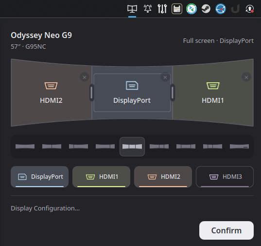

# G95NC Control for KDE Plasma

A standalone Plasma 6 widget for arranging inputs on the Samsung 57″ Odyssey Neo G9 G95NC. Switch between a single input, two or three PBP panes, and picture-in-picture from your panel.



Drag sources onto the monitor canvas, move them between panes, and drag dividers to choose a supported layout. Adding or removing sources adjusts the layout automatically. The ribbon selects a layout directly; **Confirm** applies your changes.

The compact header identifies the supported monitor and shows its current reported layout, independently of unconfirmed edits. **Display Configuration…** opens KDE’s display settings for resolution, refresh rate, and desktop arrangement. The model and screen size are fixed product information; live layout status comes from the monitor over DDC/CI.

Supported layouts: full screen, 50/50, 25/75, 75/25, thirds, 50/25/25, 25/50/25, 25/25/50, and PiP. DisplayPort and HDMI 1–3 are available sources.

## Requirements

- Samsung Odyssey Neo G9 **G95NC**, tested with model **LS57CG952NEXXY**.
- Firmware **M-C9557GGPA-1009.2** is the minimum verified version. Earlier firmware is untested.
- Linux with **KDE Plasma 6**, including the Plasma5Support QML module and its executable data engine, plus KCMUtils and KDE Display Configuration (KScreen).
- `ddcutil` at `/usr/bin/ddcutil`, Bash, coreutils, and `flock` (util-linux).
- Permission to access the monitor's I²C device as your desktop user. `ddcutil detect` must work without `sudo`.

The widget runs QML/JavaScript and a small shell transport. It does **not** require the G95NC HTTP service, Python at runtime, a browser, or an API token. Python 3 is used only by the source build/install helpers and tests.

## Build and install

From this repository:

```sh
python3 deploy/build-plasma.py
```

This creates `dist/g95nc-control.plasmoid`. Install it using Plasma's **Get New Widgets → Install Widget From Local File**, or:

```sh
kpackagetool6 --type Plasma/Applet --install dist/g95nc-control.plasmoid
```

Alternatively, build and install (or upgrade an existing installation) in one step:

```sh
python3 deploy/install-plasma.py
```

Run the installer as your desktop user, without `sudo`. Add **G95NC Control** to your panel, open its settings, and enter your monitor's serial number from:

```sh
ddcutil detect
```

For a manual upgrade, use `--upgrade` instead of `--install`. If Plasma continues showing an older UI, log out and back in to clear its QML cache.

## How it works

The widget communicates with the monitor over DDC/CI through `ddcutil`. JavaScript interprets Samsung's vendor-specific VCP registers `E2` (layout) and `E3` (pane inputs), plus standard VCP `60` (main input).

On confirmation, it reads the monitor, changes the PBP mode when necessary, and verifies the mode **before assigning inputs**. For supported two-pane reversals it uses the monitor's native swap command. Other transitions use a spare input where necessary to avoid duplicate assignments. Writes include settling time and are not automatically retried.

A short-lived shell process holds a per-monitor `flock` for the entire transaction. The lock uses the monitor serial's SHA-256 hash under `${TMPDIR:-/tmp}/g95nc-<uid>/`, allowing cooperating controllers to avoid overlapping operations. Status refreshes while the popup is open; editing the canvas does not change the monitor until you confirm.

These commands were reverse engineered from firmware and verified with register captures and hardware testing. Some packed three-pane input status remains undecoded, so final input verification is limited in those modes. The widget controls the monitor's layout; it does not configure KDE display resolutions or GPU outputs.

## Development and tests

No npm dependencies or compilation are needed. Run the offline protocol, layout, packaging, and transport checks:

```sh
node tests/test_plasma_layout.cjs
node tests/test_plasma_protocol.cjs
python3 -m unittest discover -s tests -p 'test_*.py'
```

For QML integration tests, install the Plasma QML modules and Qt 6 Quick Test library (`libQt6QuickTest.so.6`), then run:

```sh
python3 tests/run_plasma_ui.py
```

These tests substitute a simulated DDC transport and do not control a real monitor. The QML runner also generates `.runtime/plasma-widget.png`.

Widget source lives in `plasma/com.obezuk.g95nc/`. The package ID is retained so installations from the original service project can be upgraded in place.

## Automated builds and releases

The [build workflow](.github/workflows/build.yml) runs the offline layout, protocol, packaging, and transport tests on pushes to `main`, pull requests, and `v*` tags. You can also start it manually from GitHub Actions. QML interaction tests remain a local check on a Plasma 6 desktop.

Each successful build provides a **g95nc-control** artifact containing `g95nc-control.plasmoid` and `SHA256SUMS`, retained for 30 days. Download and extract the artifact from the workflow run to install the widget.

To publish a release, update `KPlugin.Version` in `plasma/com.obezuk.g95nc/metadata.json`, commit it, and push a matching tag (for example, `v0.3.0` for version `0.3.0`). The workflow rejects mismatched versions and, after testing, creates a GitHub release with the package, checksum, and generated release notes. No extra repository secrets are needed; only the release job receives write permission.

The original curved-monitor [icon](plasma/com.obezuk.g95nc/contents/images/g95nc.svg) is painted directly in the panel’s foreground colour, including in dark mode. Sources keep consistent colours across the canvas, buttons, and drag previews: DisplayPort blue, HDMI1 green, HDMI2 orange, and HDMI3 purple.
